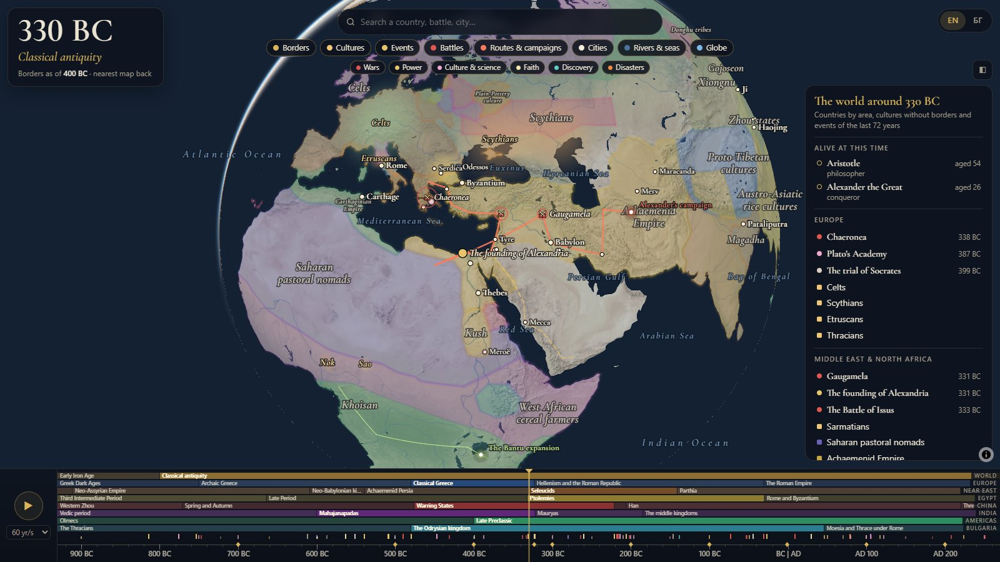
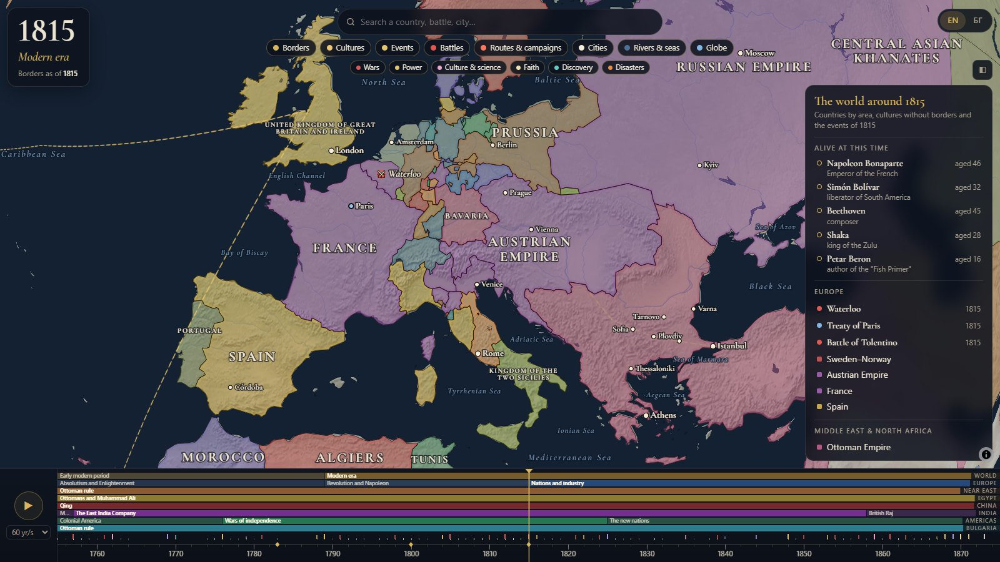
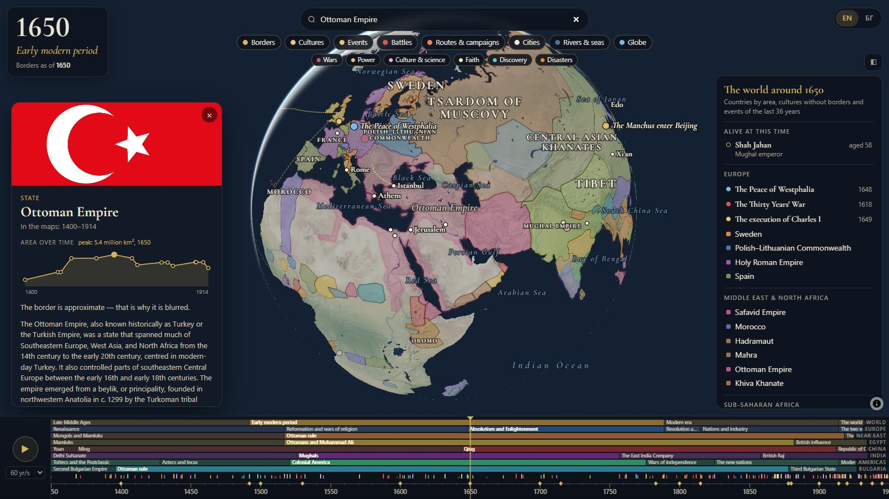
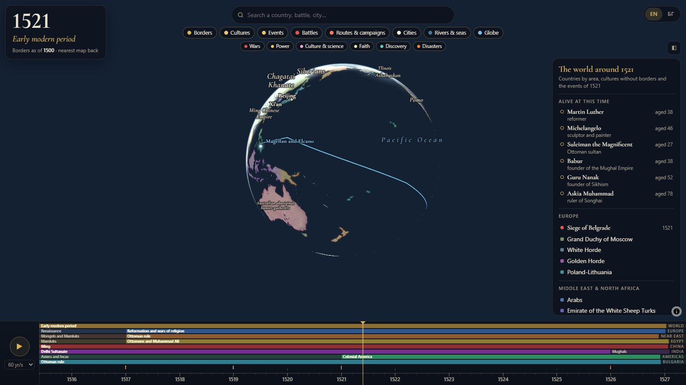
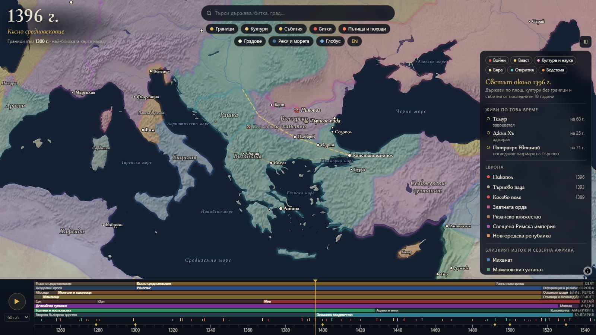
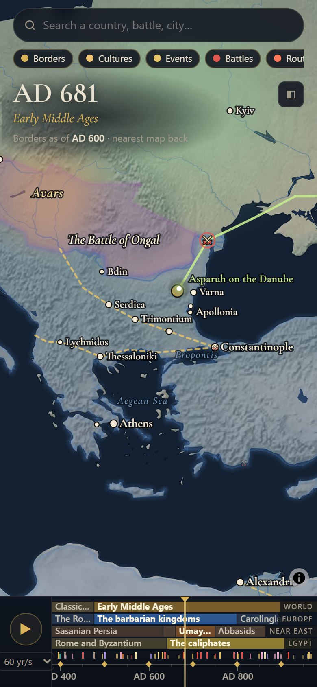

# chronoatlas — an atlas of history

A world map with a timeline underneath. Scroll the timeline and the map shows
who was where, what happened and where the armies and ships were heading — from
10,000 BC to today. Runs in the browser, works offline, English and Bulgarian.



- **Borders** of states and peoples for 58 moments in history, up to today's map with
  every state; approximate borders are drawn blurred, precise ones sharp
- **Cultures without clear borders** as glowing areas — Sumer, the Indus Valley,
  the Thracians, the Vikings
- **Over 2,000 events**: 511 hand-picked ones plus battles, treaties, summits and
  earthquakes from Wikidata — each shown in its own year, wars through theirs
- **Trade routes and campaigns** that draw themselves as time moves
- **Cities with their names through the ages** (Byzantium → Constantinople → Istanbul)
  and **seas with their old names** (Pontus Euxinus, Propontis, Mare Nostrum)
- **Around the world at the same time** — a side panel with what existed in the
  chosen year, by region, and who was alive
- **Eras in eight tracks** (world, Europe, Near East, Egypt, China, India, the Americas,
  Bulgaria), **search**, **▶ play**, and a link to every moment and card
  (`#y=-490&o=event:battle-of-marathon`)

| | |
|---|---|
|  |  |
|  |  |

<p align="center"></p>

## Install

You need Node.js 20+ and Python 3.

```
git clone https://github.com/AngelGrigorov/chronoatlas.git
cd chronoatlas
npm install
npm run serve
```

Open http://localhost:8642. The `public/` folder is the whole site and can be served
by any static web server. It needs nothing from the internet, and once opened it
also works with no network (a service worker keeps what has been seen); only the
Wikipedia summaries in the cards need a connection.

## Controls

| | |
|---|---|
| mouse wheel over the timeline | move through time |
| Ctrl + wheel, pinch | zoom the timeline |
| drag the timeline | move through time |
| double-click an era | fit the era |
| ← → | move through time |
| `,` `.` | previous / next event |
| space | play / pause |
| `/` | search |

## Languages

English is the default. The **БГ** button downloads the Bulgarian language pack once
and keeps it in the browser (localStorage), so it works offline afterwards.

All texts live in `tools/i18n/<lang>/` — interface strings, the texts of every event,
culture, route, person, city, sea and era (by id), Wikidata titles and polity names.
`npm run i18n` builds the packs in `public/data/i18n/` and fails if any id lacks a text.

## Data and licence

- Borders: [historical-basemaps](https://github.com/aourednik/historical-basemaps) by A. Ourednik — GPL-3.0;
  from 1985 on, Natural Earth admin-0 countries, with what changed since undone for each
  year (the USSR, Yugoslavia, Czechoslovakia, Sudan before 2011…). The borders between the
  two Germanys and the two Yemens, which Natural Earth no longer has, are drawn by hand
  along their known course. Crimea is drawn as part of Ukraine, as the UN General Assembly
  recognises it
- Relief, land, rivers, countries: [Natural Earth](https://www.naturalearthdata.com/) — public domain
- Events: [Wikidata](https://www.wikidata.org/) — CC0
- Map: [MapLibre GL JS](https://maplibre.org/) — BSD-3
- Font: Cormorant Garamond — SIL OFL 1.1

The code is licensed under GPL-3.0 (`LICENSE`).
